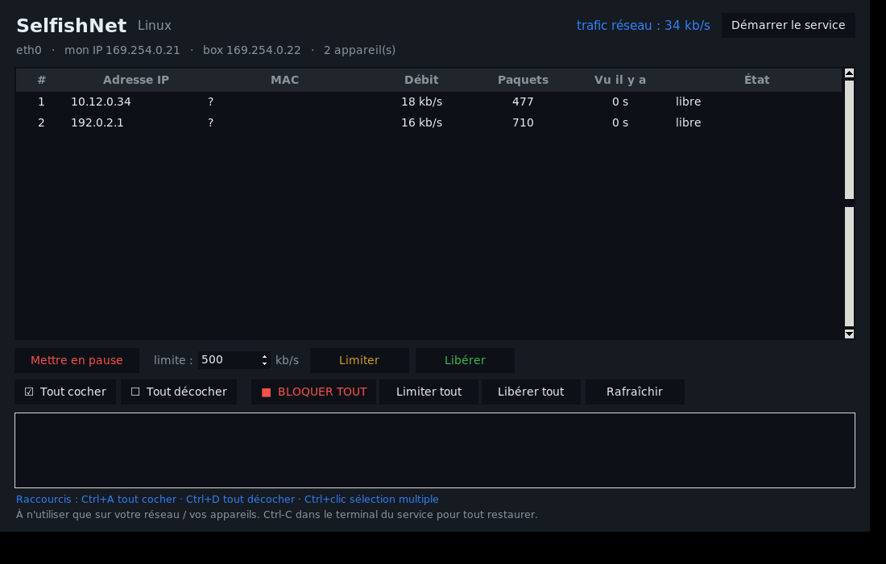

# SelfishNet — Contrôleur de bande passante Wi-Fi / LAN (Linux, Windows & Android Companion)

Quand les autres appareils du réseau saturent la connexion et que vos appels,
uploads ou agents IA ralentissent, SelfishNet vous redonne la priorité : il
**met en pause** ou **plafonne le débit** des appareils de votre choix, de façon
entièrement réversible.



---

## 1. Installation Linux

```bash
cd selfishnet-linux
bash install.sh
```

### Prérequis Linux

- Distribution Linux avec `apt`, `dnf` ou `pacman`
- Python 3.10+
- Droits administrateur (`sudo`) pour le démon réseau
- Outils système : `iptables`, `ip`, `tc`, `tcpdump`
- Tkinter pour l'interface graphique (`python3-tk`)

Le script installe les dépendances, crée le groupe système `selfishnet` (pour
permettre à votre utilisateur de piloter le démon depuis la GUI **sans `sudo`**),
copie les modules dans `/usr/local/lib/selfishnet`, installe les commandes
`selfishnet` et `selfishnet-gui`, et configure le service `systemd`.

> Après l'installation, reconnectez votre session (ou exécutez `newgrp selfishnet`)
> pour que l'accès au socket `/run/selfishnet.sock` soit actif sans `sudo`.

Installation manuelle :

```bash
sudo apt install python3-scapy python3-tk iptables iproute2 tcpdump
sudo python3 selfishnet.py doctor
```

Démarrage :

```bash
sudo selfishnet doctor            # vérifie la machine (inclut diagnostic IPv6)
sudo selfishnet daemon            # ou : sudo systemctl enable --now selfishnet
selfishnet-gui                    # interface graphique (sans sudo !)
```

---

## 2. Version Windows (v1.1)

Téléchargez `SelfishNet-Windows-<date>.zip` depuis les artefacts GitHub Actions
(**Build Windows release**), extrayez-le puis lancez `SelfishNet-GUI.exe` (l'élévation
UAC Administrateur est demandée automatiquement).

### Prérequis Windows

- Windows 10 / 11 64 bits
- **Npcap** (<https://npcap.com/#download>) installé avec le mode compatible WinPcap

### Fonctionnalités Windows incluses

- Découverte passive + **balayage ARP actif (`F5`)** filtré strictement sur le sous-réseau local
- Mesure temps réel du débit (**↑ montant / ↓ descendant**) et identification fabricant OUI hors-ligne
- **Pause** (empoisonnement ARP + Pare-feu Windows multi-langues) et **Limite en kb/s** (relais L2 Npcap + Token Bucket)
- **Safe Mode persistant** (PC local et passerelle protégés en permanence), **alias personnalisés** et **minuteur automatique**
- Nettoyage garanti des règles (via PowerShell, indépendant de la langue Windows) et restauration ARP à la fermeture

### Construire les releases soi-même

```bash
# Linux (démon + GUI + SHA256SUMS)
bash build-release.sh
```

```powershell
# Windows PowerShell (EXE avec icône + SHA256SUMS)
.\build-windows.ps1
```

---

## 3. Préparation Android (Companion + Root/Hotspot)

Le démon intègre désormais une **API REST authentifiée (Bearer token)** prête pour
une application compagnon Android sans root :

```bash
sudo selfishnet daemon --api-bind 0.0.0.0 --api-port 8443
```

Le démon affiche une URI `selfishnet://pair?...` prête pour l'appairage par QR Code.
Consultez [docs/ANDROID_ARCHITECTURE.md](docs/ANDROID_ARCHITECTURE.md) pour le contrat API complet et l'architecture Android (Companion sans root, mode Root/Hotspot natif et connecteurs box).

---

## 4. Utilisation

### a) Interface graphique (Linux & Windows)

```bash
selfishnet-gui          # Linux (utilisateur normal)
```

- **Sélection rapide** : `Tout sélectionner` (`Ctrl+A`), `Tout désélectionner` (`Ctrl+D`), `Ctrl+clic`, `F5` (balayage ARP actif)
- **Actions** : `Mettre en pause`, `Limiter` (en kb/s), `Durée` (minuteur auto en minutes, `0 = ∞`), `Libérer`, `Bloquer tout`, `Limiter tout`, `Libérer tout`
- **Safe Mode & Alias** : `Protéger (Safe Mode)`, `Retirer protection`, `Renommer`

### b) Console interactive (Linux / SSH)

```bash
sudo selfishnet watch
```

| Touche | Effet |
|---|---|
| `1`, `2`, …, `12` | pause / reprendre l'appareil n° X |
| `l` | limiter **tous les appareils non protégés** (500 kb/s par défaut) |
| `p` | mettre **tous les appareils non protégés** en pause |
| `f` | tout libérer |
| `r` | lancer un balayage ARP actif du réseau |
| `q` | quitter **et restaurer le réseau** |

### c) Ligne de commande (scriptable)

```bash
sudo selfishnet scan                       # découvrir les appareils (--json dispo)
sudo selfishnet pause 3                    # coupe l'appareil n°3
sudo selfishnet pause 3 --duration 600     # pause automatique de 10 minutes
sudo selfishnet pause 2,4                  # plusieurs appareils d'un coup
sudo selfishnet pause local                # coupe tous les appareils non protégés
sudo selfishnet limit 3 --rate 200         # 200 kb/s maxi
sudo selfishnet free 3                     # rend l'appareil à la normale
sudo selfishnet free all                   # tout le monde
sudo selfishnet safe add 192.168.1.25      # protège un appareil en Safe Mode
sudo selfishnet alias set 192.168.1.25 "TV Salon"
sudo selfishnet status --json              # état courant au format JSON
sudo selfishnet quit                       # arrête le service + restaure tout
```

---

## 5. Sécurité, réversibilité & limites honnêtes

- **Sécurité IPC** : le socket `/run/selfishnet.sock` est restreint au groupe `selfishnet` (`0660`), toutes les commandes système sont exécutées sans shell (`shell=False`) avec validation stricte IPv4/MAC/interface.
- **Sortie propre** : à `q`, `Ctrl-C`, `quit` ou `systemctl stop`, les tables ARP sont restaurées, les règles `iptables`/`ip6tables`/`tc` sont supprimées et `net.ipv4.ip_forward` est restauré à son état initial. Filet de sécurité : `sudo selfishnet clean`.
- **IPv6** : `sudo selfishnet doctor` signale si IPv6 est actif sur le Wi-Fi (sur une box client classique, IPv6 peut contourner un blocage IPv4 seul).
- **AP Isolation** : si la box active l'isolation des clients Wi-Fi, l'ARP spoofing ne peut pas intercepter le trafic ; vérifiez avec `sudo selfishnet selftest <IP>`.

---

## 6. Désinstallation Linux

```bash
bash uninstall.sh
```

---

## 7. Avertissement légal

Cet outil modifie le trafic du réseau local. Ne l'utilisez que sur **votre propre réseau**
et sur des appareils dont vous êtes responsable (votre box, votre partage de connexion,
votre domicile).

---

## 8. Architecture des fichiers

| Fichier | Rôle |
|---|---|
| `selfishnet_core.py` | Noyau partagé (validation stricte, OUI, alias, minuteurs, TokenBucket, IPC, API Companion Android) |
| `selfishnet.py` | Moteur Linux (ARP, iptables/ip6tables, tc HTB/ingress), démon IPC, CLI & TUI |
| `selfishnet_tui.py` | Interface graphique Tkinter Linux (client IPC asynchrone) |
| `selfishnet_windows.py` | Backend natif Windows (Npcap, ARP, relais L2 TokenBucket, Pare-feu PowerShell) |
| `selfishnet_windows_tui.py` | Interface graphique Tkinter Windows (thème sombre, parité complète) |
| `assets/` | Icônes (`svg`, `png`, `ico`) et base OUI hors-ligne (`oui.txt`) |
| `docs/ANDROID_ARCHITECTURE.md` | Spécification technique & contrat API Android |
| `install.sh` / `uninstall.sh` | Installation et désinstallation Linux |
| `selfishnet.service` | Unité systemd sécurisée |
| `build-release.sh` / `build-windows.ps1` | Scripts de packaging Linux et Windows |
| `tests/` | Suite de tests automatisés `pytest` |
